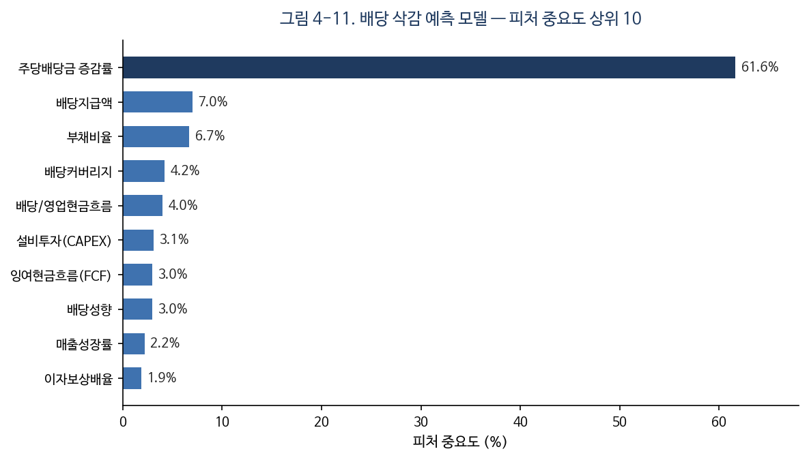

최종 보고서

프로젝트명: AI 현금흐름 운영체제(Cashflow OS) — 배당 삭감 예측 기반 소득 지속성 분석 시스템

1. 프로젝트 개요

1.1 개요 (배경 및 필요성)

저금리 기조의 장기화와 고령화에 따른 노후 소득 불안으로 인해, 매달 일정한 현금흐름을 만들어 내는 배당 투자에 대한 개인 투자자의 관심이 빠르게 증가하고 있다. 그러나 현재의 배당 투자 환경에는 두 가지 근본적인 문제가 있다.

첫째, 기존 서비스는 특정 종목이나 ETF를 추천하는 수준에 머물러 있어, 투자자가 실제로 궁금해하는 질문에 답하지 못한다. 투자자가 알고 싶은 것은 "어떤 종목이 좋은가"보다 "내가 목표한 월배당을 언제 달성할 수 있는가", 그리고 "그 소득이 20년 뒤에도 유지되는가"이다.

둘째, 배당수익률이 높은 종목일수록 향후 배당 삭감 위험이 크지만, 투자자는 현재의 배당수익률만으로 미래 현금흐름의 안정성을 판단하기 어렵다. 배당 삭감은 자주 발생하지는 않으나 한 번 발생하면 투자자의 현금흐름에 직접적인 충격을 준다.

본 프로젝트는 이러한 문제를 해결하기 위해 배당 삭감 예측 머신러닝 모델과 포트폴리오 생존확률 분석을 결합한 AI 현금흐름 운영체제를 설계하고 구현하였다. 본 시스템의 핵심 지표는 단순 수익률 극대화가 아니라 "목표한 월배당 소득을 얼마나 안정적으로 유지할 수 있는가", 즉 소득 지속성이다. 이를 통해 투자자가 높은 배당수익률을 좇는 대신 지속 가능한 현금흐름을 설계하고 관리할 수 있도록 지원하는 것을 목표로 한다.

1.2 주요 내용 (특징, 기능, 사용할 기술 및 방법론)

본 시스템의 가장 큰 특징은 단순한 자산 추천기가 아니라 "설계 - 검증 - 설명 - 관리"의 전 과정을 하나로 잇는 운영체제 형태라는 점이다. 또한 수익률로 경쟁하지 않고 목표 소득의 지속성을 핵심 가치로 삼아 기존 서비스와 차별화하였다.

주요 기능은 다음과 같다.

첫째, 배당 삭감 예측 기능이다. XGBoost 기반 3-클래스 분류 모델을 사용하여 종목의 배당 상태를 INTACT(유지), WEAKENING(약화), BROKEN(삭감)으로 예측하고, SHAP 기법으로 그 판단 근거를 제시한다.

둘째, 포트폴리오 생존확률 분석 기능이다. 종목별 배당 삭감 확률과 섹터·국가 단위 상관충격을 함께 반영하여, 현재 포트폴리오의 월배당 소득이 장기간 유지될 확률을 계산한다.

셋째, 위험 기여도 분석이다. 단순 비중이 아니라 실제 위험 기여도를 계산하여, 비중과 위험의 괴리를 시각적으로 드러낸다.

넷째, FIRE 목표 분석이다. 사용자의 나이, 투자금, 적립금 증가율, 목표 월배당, 투자 성향을 입력받아 목표 달성 시점을 역산하고, Monte Carlo 시뮬레이션으로 달성 확률과 시나리오를 제공한다.

이 밖에 2026년 개정 세법을 반영한 ISA 절세 전략, 21년 백테스팅, 행동편향 진단, 사용자 로그인 및 포트폴리오 저장 기능을 제공한다.

사용한 기술 및 방법론은 다음과 같다. 머신러닝은 XGBoost 3-클래스 분류와 SHAP TreeExplainer를 사용하였다. 검증에는 데이터 누수를 방지하기 위한 종목 단위 GroupKFold, 미래 일반화를 확인하기 위한 Out-of-Time Forward Backtest, 불균형 데이터에 적합한 PR-AUC 지표를 사용하였다. 미래 소득 시뮬레이션에는 Monte Carlo 기법과 섹터 상관충격 모델을 적용하였다. 데이터는 국내의 경우 금융감독원 DART Open API, 미국의 경우 yfinance를 통해 수집하였다.

1.3 기대 효과 및 활용 방안

본 시스템을 통해 투자자는 "높은 배당률"이 아니라 "지속 가능한 현금흐름"이라는 관점에서 의사결정을 내릴 수 있다. 목표 월배당 달성 경로와 진행률을 시각적으로 제공함으로써 장기 자산관리의 동기를 부여하며, 배당 삭감 위험 종목을 사전에 경고하여 소득 충격을 방어할 수 있다.

기존 투자 서비스가 수익률 중심의 자산 추천에 집중한 것과 달리, 본 연구는 소득 지속성이라는 새로운 평가 관점을 제시하였다는 데 의의가 있다. 특히 배당 삭감 예측과 포트폴리오 생존확률을 결합하여, "얼마를 벌 수 있는가"가 아니라 "그 소득이 얼마나 오래 살아남는가"를 정량적으로 평가할 수 있음을 보였다.

활용 방안으로는 개인 자산관리 교육용 도구, 핀테크 배당 분석 서비스의 프로토타입, 투자 의사결정 보조 도구 등을 들 수 있다. 다만 본 시스템은 교육 및 연구 목적의 의사결정 지원 도구이며, 실제 투자 수익을 보장하지 않는다.

2. 국내·외 관련 분야 현황

기존의 배당 투자 서비스와 관련 기술은 주로 배당수익률, 배당성장률, 총수익률을 중심으로 투자 대상을 추천한다. 대표적인 사례를 비교하면 다음과 같다.

SCHD, QLD와 같은 ETF는 분산된 배당 또는 성장 자산을 제공하지만, 이는 "자산"일 뿐 개인의 목표나 소득 지속성에 대한 계획을 제공하지 못한다.

미국의 Simply Safe Dividends는 배당 안전성 점수를 제공하나 룰 기반 평가에 머무르며 한국 종목이나 개인 목표는 지원하지 않는다.

Seeking Alpha와 Portfolio Visualizer는 종목 분석과 백테스트 기능이 강력하지만 과거 분석에 집중되어 있어, 미래 소득의 생존확률이나 FIRE 목표 역산 기능은 제공하지 않는다.

국내 증권사 애플리케이션은 시세, 랭킹, 배당 정보를 제공하나 배당 삭감 예측이나 목표 달성 시뮬레이션은 다루지 않는다.

이러한 기존 서비스들은 다음과 같은 공통적인 한계를 가진다. 첫째, 투자자의 목표 소득 달성 여부를 계산하지 않는다. 둘째, 배당 삭감 가능성을 정량적으로 평가하지 않는다. 셋째, 장기간 소득 유지 가능성을 분석하지 않는다. 넷째, 추천 결과에 대한 설명 가능성이 부족하다.

본 프로젝트는 배당 삭감 예측, 소득 지속성 평가, 목표 달성 시뮬레이션을 하나로 통합하여 위 네 가지 한계를 동시에 해결한다는 점에서 기존 서비스와 차별화된다.

3. 프로젝트 개발 환경

운영체제: macOS 및 Linux(Ubuntu)
개발 언어: Python 3.10, JavaScript(ES2022)
백엔드 프레임워크: FastAPI(uvicorn)
프론트엔드 프레임워크: React 18, Vite, Recharts
머신러닝 및 분석 라이브러리: XGBoost, scikit-learn, SHAP, pandas, numpy
데이터 수집: DART Open API(국내), yfinance(미국)
데이터 저장: PostgreSQL 및 파일(JSON/CSV) 폴백 구조, 사용자 데이터는 파일 기반 저장(비밀번호 SHA-256 해시)
테스트: pytest(총 149개 테스트 통과)
형상관리: Git

4. 프로젝트 설계 및 구현

4.1 아키텍처

본 시스템은 FastAPI 기반 백엔드와 React 기반 프론트엔드로 구성된다. 백엔드의 추천 로직은 Pipe-and-Filter 패턴으로 구현하였다. 18개의 독립적인 필터가 정해진 순서로 동작하며, 각 필터는 공유 상태 객체를 읽고 자신의 분석 결과를 다시 기록한다. 특정 필터에서 오류가 발생하더라도 전체 파이프라인이 중단되지 않도록 오류 격리 구조를 적용하였다.

파이프라인의 동작 순서는 다음과 같다. 거시경제 분석, 자산 선별, 종목 평가, 비중 배분, 배당 삭감 예측, Monte Carlo 시뮬레이션, 생존확률 계산, 위험 및 세금 및 행동편향 분석, 설명 생성의 순서로 진행되며, 최종적으로 JSON 형태의 응답을 반환한다. 프론트엔드는 이 응답을 받아 대시보드 형태로 렌더링하며, 사용자 인증과 포트폴리오 저장은 별도의 인증 모듈이 담당한다.

4.2 설계도

본 시스템의 설계는 크게 세 부분으로 나뉜다. 첫째는 추천 로직을 구성하는 객체지향 클래스 구조이고, 둘째는 사용자 데이터를 저장하는 데이터베이스 구조이며, 셋째는 머신러닝 모델이 학습하는 데이터의 피처 구조이다. 각각을 설명하면 다음과 같다.

(1) 객체지향 설계 (클래스 구조)

추천 로직은 "파이프라인 - 필터 - 공유 컨텍스트"라는 세 종류의 클래스로 설계하였다. 이는 하나의 큰 함수가 모든 일을 처리하는 대신, 기능을 독립적인 작은 단위로 쪼개어 조립하는 Pipe-and-Filter 패턴을 객체지향으로 구현한 것이다.

첫째, RecommendationPipeline은 전체 분석을 지휘하는 제어 클래스이다. 내부에 공유 상태 객체(ctx)와 필터들의 목록(filters)을 속성으로 가지며, execute()라는 메서드 하나가 등록된 필터들을 정해진 순서대로 차례로 호출한 뒤, 그 결과를 모아 JSON 형태의 응답으로 변환한다.

둘째, BaseFilter는 모든 필터의 공통 뼈대가 되는 추상 클래스이다. 필터의 이름을 나타내는 name 속성과, 실제 작업을 수행하는 process(ctx)라는 추상 메서드 하나만을 규정한다. 구체적인 필터들은 모두 이 BaseFilter를 상속받아 process 메서드 하나만 자신의 목적에 맞게 구현하면 된다. 따라서 새로운 기능을 추가할 때는 BaseFilter를 상속한 클래스를 하나 더 만들어 파이프라인에 등록하기만 하면 되고, 기존 코드는 수정할 필요가 없다.

셋째, BaseFilter를 상속한 구체 필터는 총 20개이다. 이들은 정해진 순서로 실행되는데, 그 흐름은 다음과 같다. 거시경제 레짐을 판단하는 MacroRegimeFilter와 평가 축의 가중치를 정하는 AxisWeightFilter로 시작하여, 자산을 선별하는 AssetPickerFilter, 비중을 배분하는 WeightAllocatorFilter, 요약·예측·리밸런싱·스트레스테스트·섹터노출·배당캘린더·위험경고를 담당하는 필터들이 이어진다. 그다음 FireEngineFilter가 목표 달성 시점을 역산하고, MonteCarloFilter가 미래 시나리오를 시뮬레이션하며, SurvivalFilter가 소득 생존확률을 계산한다. 마지막으로 TaxOptimizerFilter(세금), BehavioralFinanceFilter(행동편향), YieldTrapFilter(고배당 함정), PortfolioHealthFilter(건강도), SHAPExplainerFilter(설명), StorytellingFilter(자연어 요약)가 분석을 마무리한다.

넷째, PipelineContext는 모든 필터가 공유하는 상태 객체로, 일종의 공용 게시판 역할을 한다. 사용자의 입력값(request)을 비롯하여 추천 결과(recommendations), 거시 레짐(macro), Monte Carlo 결과(monte_carlo), FIRE 분석(fire_engine), 생존확률(survival), 세금(tax), 행동편향(behavioral) 등 20여 개의 필드를 가진다. 각 필터는 실행될 때 이 객체에서 이전 필터들이 기록해 둔 결과를 읽어 자신의 계산에 활용하고, 새로 계산한 결과를 다시 이 객체에 기록한다.

정리하면 클래스 사이의 관계는 다음과 같다. RecommendationPipeline은 PipelineContext 객체 하나를 소유하면서 BaseFilter 목록을 순서대로 실행하고, 20개의 구체 필터는 모두 BaseFilter를 상속하며, 각 필터는 PipelineContext를 매개로 데이터를 주고받는다. 또한 특정 필터에서 오류가 발생하더라도 해당 필터의 결과만 비워 둔 채 다음 필터로 계속 진행하도록 설계하여, 한 부분의 실패가 전체 분석을 중단시키지 않는다.

(이 구조를 도식화한 것이 [그림 4-1] 클래스 다이어그램이다.)

(2) 데이터베이스 설계 (엔티티 구조)

사용자 인증과 포트폴리오 저장 기능은 별도의 데이터베이스 서버 없이도 동작하도록 파일 기반(JSON) 저장소로 구현하였다. 논리적 구조는 세 개의 엔티티로 구성된다.

첫째, users 엔티티는 가입한 사용자를 나타낸다. 이메일(email)을 기본 키로 사용하고, 비밀번호를 안전하게 보관하기 위한 salt 값과 해시값(pwd_hash), 그리고 가입 일시(created_at)를 속성으로 가진다. 비밀번호는 평문으로 저장하지 않으며, salt와 비밀번호를 결합한 뒤 SHA-256으로 해시한 값만 저장한다.

둘째, saved_portfolios 엔티티는 사용자가 저장한 분석 결과를 나타낸다. 고유 식별자(id)를 기본 키로 가지고, 소유자(owner)를 외래 키로 두어 users 엔티티와 연결한다. 그 밖에 포트폴리오 이름(name), 생성 일시(created_at), 목록 표시에 쓰이는 요약 정보(summary, 건강도·생존확률·달성 나이·월배당 등), 그리고 전체 추천 결과(payload)를 속성으로 가진다.

셋째, auth_tokens 엔티티는 로그인 세션을 나타낸다. 토큰 문자열(token)을 기본 키로, 해당 토큰이 어느 사용자의 것인지를 가리키는 이메일(email)을 외래 키로 가진다.

엔티티 사이의 관계를 보면, users와 saved_portfolios는 1:N 관계로, 한 사용자가 여러 개의 포트폴리오를 저장할 수 있다. auth_tokens는 로그인 시 발급되는 세션 토큰을 사용자에 매핑한다.

(이 구조를 도식화한 것이 [그림 4-2] 엔티티 관계도(ERD)이다.)

(3) 머신러닝 피처 설계 (학습 데이터 구조)

배당 삭감 예측 모델이 학습하는 데이터는 한 종목·한 연도를 하나의 행으로 하여, 총 13개의 피처와 1개의 타깃 변수로 구성된다.

피처는 성격에 따라 네 묶음으로 나뉜다. 현금흐름 관련 피처는 영업현금흐름, 잉여현금흐름, 설비투자(CAPEX), 배당지급액, 그리고 잉여현금흐름이 음수인지 여부이다. 비율 관련 피처는 배당성향, 배당커버리지, 배당 대비 영업현금흐름 비율, 영업현금흐름 대비 설비투자 비율이다. 재무 건전성 관련 피처는 부채비율, 이자보상배율, 매출성장률이다. 배당 관련 피처는 주당배당금의 전년 대비 증감률이다.

타깃 변수는 label3으로, 배당 상태를 세 단계로 구분한다. 0은 INTACT(유지), 1은 WEAKENING(약화), 2는 BROKEN(삭감)을 의미한다. 즉 모델은 위 13개 피처를 입력받아 해당 종목이 다음 시점에 세 상태 중 어디에 속할지를 분류한다.

4.3 구현 화면

[그림 4-3] 입력 화면
나이, 월 투자금, 적립금 증가율, 목표 월배당, 투자 성향을 입력한다. 데모용 페르소나 네 종(25세, 35세, 45세, 60세)을 제공하여 즉시 결과를 확인할 수 있다.

[그림 4-4] 결과 대시보드 헤드라인
목표 월배당과 예상 달성 나이, FIRE 진행률 게이지, 자산 진행률, 현재 단계를 한 화면에 요약한다. "분석 보고서"가 아니라 "지금 무엇을 해야 하는가"가 먼저 보이도록 배치하였다.

[그림 4-5] 추천 포트폴리오
상위 종목과 비중을 보여주며, 각 종목이 포트폴리오에서 맡은 역할(월배당 현금흐름, 장기 배당성장, 방어 등)을 태그로 표시한다.

[그림 4-6] 오늘의 액션
위험 경고, 집중도, ISA 절세, 배당성장 ETF 편입 등 사용자가 바로 실행할 수 있는 권고를 자동으로 생성한다.

[그림 4-7] 현금흐름 여정 타임라인
현재 시점부터 목표 달성, Lean FIRE, 일반 FIRE까지의 경로를 시간 순으로 시각화한다.

[그림 4-8] 상세 분석 화면
소득 지속성 점수, 생존확률, 위험 기여도, Monte Carlo 결과(P10/P50/P90), SHAP 설명, 21년 백테스팅 결과를 제공한다.

[그림 4-9] SHAP 설명 화면
배당 위험으로 분류된 종목에 대해, 어떤 재무 지표가 그 판단에 기여했는지를 막대 형태로 제시한다.

[그림 4-10] 사용자 기능 화면
로그인 및 회원가입, 포트폴리오 저장, 내 포트폴리오 목록과 불러오기, 지난 분석 대비 변화 추적을 제공한다.

(각 [그림]에는 실제 구현 화면 캡처를 삽입한다.)

4.4 성능 평가 및 결과 분석

4.4.1 학습 데이터

국내 데이터는 DART Open API를 통해 2013년부터 2025년까지 수집하였으며, 총 210개 종목, 1,679개 관측치로 구성된다. 이 중 배당 삭감(또는 약화) 비율은 약 22퍼센트이다. 배당 삭감은 상대적으로 드물게 발생하는 불균형 데이터이므로, 정확도(Accuracy) 대신 정밀도-재현율 곡선 아래 면적(PR-AUC)을 주요 평가 지표로 사용하였다.

4.4.2 모델 비교 및 최종 모델 선정

동일한 13개 피처와 동일한 종목 단위 GroupKFold 검증(5-fold) 조건에서 세 가지 분류 모델을 비교하였다. 평가는 배당 위험(WEAKENING 또는 BROKEN) 여부를 양성으로 둔 이진 분류의 PR-AUC와 ROC-AUC로 측정하였다. 무작위 분류기의 기준선 PR-AUC는 0.385이다.

| 모델 | PR-AUC | ROC-AUC |
|---|---|---|
| 기준선(무작위) | 0.385 | - |
| Logistic Regression | 0.670 | 0.735 |
| Random Forest | 0.799 | 0.793 |
| Gradient Boosting | 0.801 | 0.798 |
| XGBoost (최종 채택) | 0.801 | 0.801 |

선형 모델인 Logistic Regression은 PR-AUC 0.670으로 비선형 관계를 충분히 포착하지 못하였다. 반면 트리 기반 앙상블 모델(Random Forest, Gradient Boosting, XGBoost)은 PR-AUC가 모두 0.80 부근으로 수렴하였다. 이는 본 문제의 예측력이 특정 알고리즘이 아니라 피처 자체에서 나온다는 것을 시사한다. 그중 XGBoost를 최종 모델로 채택한 이유는 다음과 같다. 첫째, ROC-AUC가 0.801로 가장 높았다. 둘째, SHAP TreeExplainer와의 호환성이 우수하여 예측 근거 설명 기능을 안정적으로 구현할 수 있었다. 셋째, scale_pos_weight를 통한 클래스 불균형 보정이 용이하였다.

위험 확률 상위 20퍼센트 종목을 경고했을 때의 정밀도는 0.96으로 측정되었다. 이는 위험하다고 경고한 종목 중 96퍼센트가 실제로 배당 위험에 해당함을 의미하며, 경고 시스템으로서의 실용성이 높음을 보여준다.

4.4.3 미래 일반화 검증 (Out-of-Time Forward Backtest)

교차검증은 "처음 보는 종목"에 대한 일반화는 보장하지만 "처음 보는 미래"에 대한 일반화는 보장하지 못한다. 이를 검증하기 위해, 특정 연도 이전 데이터만으로 학습한 뒤 해당 연도를 예측하는 워크포워드 방식의 Out-of-Time Backtest를 2019년부터 2024년까지 수행하였다.

| 연도 | PR-AUC | 상위 20% 정밀도 | 상위 20% 재현율 |
|---|---|---|---|
| 2019 | 0.790 | 0.95 | 0.43 |
| 2020 | 0.856 | 1.00 | 0.51 |
| 2021 | 0.763 | 0.89 | 0.44 |
| 2022 | 0.846 | 1.00 | 0.47 |
| 2023 | 0.814 | 1.00 | 0.53 |
| 2024 | 0.835 | 0.95 | 0.58 |
| 전체(pooled) | 0.803 | 0.96 | 0.49 |

연도별 PR-AUC가 0.76에서 0.86 사이로 안정적으로 유지되었고, 코로나19가 발생한 2020년을 포함한 최근 연도에서도 성능 저하가 나타나지 않았다. 이는 모델이 특정 시기에만 우연히 좋은 것이 아니라, 여러 기간에 걸쳐 미래 데이터에서도 안정적인 예측력을 유지함을 보여준다.

4.4.4 추천 포트폴리오 백테스트 성과

추천된 포트폴리오를 2005년부터 2024년까지의 실제 데이터(2008년 금융위기, 2020년 코로나 위기 포함)로 백테스트한 결과는 다음과 같다.

| 지표 | 추천 포트폴리오 |
|---|---|
| 연복리 수익률(CAGR) | 8.6% |
| 최대낙폭(MDD) | -34.2% |
| 샤프 지수(Sharpe) | 0.52 |
| 소르티노 지수(Sortino) | 0.85 |
| KOSPI 대비 초과수익 | +0.9%p |

장기적으로 은행 예금 금리(3.5퍼센트 가정)를 크게 상회하는 수익률을 보였으며, 위험 조정 성과 또한 양호하였다. 다만 본 시스템의 머신러닝은 배당 삭감 위험 예측에 특화된 것으로, 총수익률(주가) 자체를 예측하는 것은 아니며, 그 가치는 소득 안정성 측면에 있다.

4.4.5 사례 연구

본 시스템의 활용을 구체적으로 보이기 위해, 다음과 같은 가상 사용자에 대한 분석 결과를 제시한다.

입력 조건
- 현재 나이: 25세
- 시작 투자금: 552만원
- 월 적립금: 50만원(연 7퍼센트씩 증액, 소득 상승 반영)
- 목표 월배당: 200만원
- 투자 성향: 공격형(세후 배당수익률 약 6.4퍼센트 가정)

연도별 자산 및 월배당 궤적 (시스템 FIRE 엔진 계산값)

| 나이 | 누적 자산(만원) | 월배당(명목, 만원) |
|---|---|---|
| 25세(현재) | 552 | 2.9 |
| 32세 | 7,280 | 38.8 |
| 38세 | 18,948 | 101.1 |
| 44세(목표 도달) | 40,202 | 214.4 |
| 50세 | 77,590 | 413.8 |

핵심 분석 결과

| 항목 | 결과 |
|---|---|
| 목표 달성 예상 나이(명목 기준) | 44세 |
| 목표 달성 나이(물가 반영 실질 기준) | 49세 |
| 소득 생존확률(현재 소득 유지) | 99% |
| 현금흐름 건강도 | 95점 |
| 현재 진행률(월배당 2.9만 ÷ 목표 200만) | 약 1.5% |

해당 사용자는 25세에 552만원의 자산에서 시작하여 매년 적립금을 7퍼센트씩 늘릴 경우, 명목 기준 44세에 목표 월배당 200만원에 도달한다. 한편 물가 상승(연 2.5퍼센트)을 반영한 실질 기준으로는 약 49세에 도달하는데, 본 시스템은 이처럼 명목과 실질 두 기준을 모두 제공하여 사용자가 인플레이션의 영향을 함께 인식하도록 설계하였다. 또한 적립금을 매년 7퍼센트씩 늘리는 경우가 고정 적립보다 목표 도달을 수 년 앞당기는 것으로 나타나, 소득 상승을 반영하는 것이 복리 효과만큼이나 중요함을 확인하였다. 이처럼 본 시스템은 추상적인 점수가 아니라 "언제, 어떤 경로로 목표에 도달하는가"를 구체적으로 제시한다.

4.4.6 피처 중요도 및 설명 가능성 (SHAP)

모델이 어떤 재무 지표를 근거로 배당 위험을 판단하는지 확인하기 위해, 학습된 모델의 피처 중요도를 분석하였다. 상위 10개 피처는 다음과 같다.

[그림 4-11] 피처 중요도 상위 10개

| 순위 | 피처 | 중요도 |
|---|---|---|
| 1 | 주당배당금 전년 대비 증감률 | 61.6% |
| 2 | 배당지급액 | 7.0% |
| 3 | 부채비율 | 6.7% |
| 4 | 배당커버리지 | 4.2% |
| 5 | 배당 대비 영업현금흐름 비율 | 4.0% |
| 6 | 설비투자(CAPEX) | 3.1% |
| 7 | 잉여현금흐름(FCF) | 3.0% |
| 8 | 배당성향 | 3.0% |
| 9 | 매출성장률 | 2.2% |
| 10 | 이자보상배율 | 1.9% |

분석 결과, 주당배당금의 전년 대비 증감률이 61.6퍼센트로 압도적인 비중을 차지하였다. 이는 직전 배당 흐름의 변화가 향후 배당 삭감의 가장 강력한 선행 신호임을 의미하며, 직관적으로도 타당하다. 그 뒤를 배당지급액, 부채비율, 배당커버리지 등 현금 지급 여력 및 재무 건전성 지표가 이었다. 한편 SHAP TreeExplainer는 이러한 전역적 중요도를 넘어, 개별 종목마다 어떤 지표가 위험 판단에 기여했는지를 종목 단위로 설명하여 [그림 4-9]와 같이 사용자에게 제시한다.

4.5 문제점 및 시행착오

프로젝트를 진행하며 다음과 같은 주요 문제를 만났고, 문제 정의와 해결, 그리고 결과를 각각 기록하였다.

(1) 국내 데이터 수집 차단

문제: 국내 시세·재무 데이터를 위해 사용한 pykrx와 FinanceDataReader가 한국거래소의 로그인 요구 및 접근 차단으로 인해 정상 동작하지 않았다.
원인 분석: 두 라이브러리 모두 한국거래소 웹사이트를 스크래핑하는 방식이어서, 거래소 측 정책 변경에 직접 영향을 받았다.
해결: 정상적으로 동작하는 금융감독원 DART Open API 기반 수집으로 전환하고, 종목별 체크포인트와 이어받기 기능을 도입하였다.
결과: 데이터 소스를 안정화하였으며, 네트워크가 중단되어도 수집된 데이터가 보존되어 210종목, 1,679관측치를 확보할 수 있었다.

(2) 검증 과정의 데이터 누수

문제: 초기 모델 검증에서 비현실적으로 높은 성능이 나왔다.
원인 분석: 사용한 시계열 분할(TimeSeriesSplit)이 종목코드 순으로 정렬된 데이터에서는 사실상 종목 그룹 분할이 되어, 동일 종목의 여러 연도가 학습과 검증에 동시에 포함되는 데이터 누수가 발생하였다.
해결: 종목 단위 GroupKFold로 교체하여 동일 종목이 학습과 검증에 동시에 포함되지 않도록 하였다.
결과: 거품이 제거된 정직한 PR-AUC 0.80이 측정되었으며, 이후 모든 평가의 신뢰할 수 있는 기준이 되었다.

(3) 미국 시장의 머신러닝 부적합

문제: 미국 종목에도 동일한 배당 삭감 예측 모델을 적용하려 했으나 성능이 매우 낮았다.
원인 분석: 미국 배당주는 대부분 배당귀족·배당왕에 해당하여 배당 삭감 사례가 약 4퍼센트로 희소하였다. 실제 학습 결과 PR-AUC가 0.05 수준이었다.
해결: 데이터가 머신러닝을 뒷받침하지 못한다고 판단하고, 미국 종목은 룰 기반 안정성 평가 방식으로 분리하였다.
결과: 무리한 머신러닝 적용 대신 데이터 특성에 맞는 방법을 선택함으로써, "데이터로 방법을 결정한다"는 합리적 의사결정 사례를 확보하였다.

(4) 화면 내 지표 기준의 불일치

문제: 동일 화면에서 목표 달성 확률이 100퍼센트와 0퍼센트로 동시에 표시되어 혼란을 주었다.
원인 분석: 한 지표는 "적립을 포함한 미래 시점"을, 다른 지표는 "현재 보유분의 배당만"을 기준으로 계산되어 기준이 서로 달랐다.
해결: 각 지표의 계산 기준을 화면에 명시하고, 핵심 지표를 단일 헤드라인(현금흐름 건강도)으로 통합하였다. 또한 확률 지표는 100퍼센트로 표시되지 않도록 상한을 적용하였다.
결과: 정보 과부하와 모순이 제거되어, "분석 보고서"에서 "개인 대시보드"로 사용자 경험이 개선되었다.

(5) 정적 데이터의 한계와 자동 확장

문제: 초기 학습 데이터가 약 30종목 수준으로 적어 모델의 일반화가 어려웠다.
원인 분석: 수동 수집에 의존하여 종목 수가 제한적이었고, 배당 삭감(양성) 표본이 부족하였다.
해결: DART 배당공시를 활용해 배당 종목을 자동으로 편입하는 유니버스 확장 기능을 구현하고, 데이터 검증 게이트와 모델 성능 회귀 추적을 함께 도입하였다.
결과: 학습 데이터를 210종목, 1,679관측치로 확장하였으며, 자동 수집과 품질 검증이 결합된 파이프라인을 확보하였다.

4.6 추후 개선 방향

첫째, 미국 데이터를 SEC EDGAR(10년 이상의 재무 데이터)로 확장하여 2008년과 2020년 위기의 배당 삭감 사례를 확보하면 미국 종목에도 머신러닝 모델을 적용할 수 있다.

둘째, 포트폴리오 단위 생존확률을 블록 부트스트랩과 다중 윈도우 방식으로 보강하여 검증력을 높일 수 있다.

셋째, 실시간 데이터 파이프라인을 통한 일 단위 자동 갱신과 클라우드 배포를 통해 교육용 데모 서비스로 전환할 수 있다.

넷째, 생존확률의 확률 보정과 섹터 상관구조의 데이터 기반 정교화를 통해 모델의 신뢰도를 더욱 향상시킬 수 있다.

5. 결론

본 프로젝트는 배당 삭감 예측 머신러닝 모델과 포트폴리오 생존확률 분석을 결합하여, 투자자의 목표 소득 달성 가능성과 소득 지속성을 평가하는 AI 현금흐름 운영체제를 설계하고 구현하였다.

배당 삭감 예측 모델은 종목 단위 GroupKFold 검증에서 PR-AUC 0.801을 달성하였으며, 2019년부터 2024년까지의 Out-of-Time Forward Backtest에서도 0.763에서 0.856 사이의 안정적인 성능을 유지하였다. 위험 확률 상위 20퍼센트 경고의 정밀도는 0.96으로, 실제 경고 시스템으로 활용하기에 충분한 신뢰도를 보였다.

본 시스템은 단순한 자산 추천에 그치지 않고 목표 달성 나이, 소득 생존확률, 현금흐름 건강도, 행동 편향 진단까지 통합 제공함으로써, 기존 배당 서비스와 차별화된 소득 중심의 투자 의사결정 지원 체계를 제안하였다. 특히 "얼마를 벌 수 있는가"가 아니라 "그 소득이 얼마나 오래 유지되는가"라는 소득 지속성 관점을 정량화한 점이 본 연구의 핵심 기여이다.

본 연구의 핵심 기여는 배당 삭감 예측 자체가 아니라, 배당 삭감 예측 결과를 포트폴리오 생존확률과 연결하여 '종목 위험'을 '미래 소득 위험'으로 변환했다는 점에 있다. 즉 삭감 예측에서 출발하여 생존확률, FIRE 목표 역산, 현금흐름 관리로 이어지는 하나의 흐름을 구성함으로써, 개별 종목의 재무 위험을 투자자가 실제로 체감하는 미래 월소득의 위험으로 환산하였다.

또한 개발 과정에서 데이터 수집 차단, 검증 데이터 누수, 시장별 모델 적합성, 지표 기준 불일치 등의 문제를 만났으며, 이를 각각 문제 정의와 원인 분석을 거쳐 해결함으로써 시스템의 신뢰성을 높였다. 향후 미국 시장 데이터 확장, 생존확률 검증 강화, 실시간 서비스화를 통해 실용성을 더욱 높일 수 있을 것으로 기대한다.

6. 프로젝트 추진 일정

| 단계 | 업무 내용 | 진행 시기 |
|---|---|---|
| 1 | 주제 선정 및 요구사항 분석 | 1개월차 |
| 2 | 데이터 수집(DART/yfinance) 및 전처리·라벨링 | 2~3개월차 |
| 3 | 머신러닝 모델 개발 및 검증(GroupKFold, Forward Backtest) | 3~4개월차 |
| 4 | 분석 파이프라인 및 웹 서비스(FastAPI, React) 구현 | 4~5개월차 |
| 5 | 사용자 인프라(로그인·저장) 및 성능 평가 | 5개월차 |
| 6 | 통합 테스트(pytest) 및 보고서·발표 자료 작성 | 6개월차 |

7. 참고문헌

[1] Chen, T., Guestrin, C., "XGBoost: A Scalable Tree Boosting System," Proceedings of the 22nd ACM SIGKDD International Conference on Knowledge Discovery and Data Mining (KDD), 2016.
[2] Lundberg, S. M., Lee, S.-I., "A Unified Approach to Interpreting Model Predictions," Advances in Neural Information Processing Systems (NIPS), 2017.
[3] Breiman, L., "Random Forests," Machine Learning, vol. 45, no. 1, pp. 5-32, 2001.
[4] 금융감독원 전자공시시스템(DART) Open API, https://opendart.fss.or.kr
[5] Yahoo Finance(yfinance), https://finance.yahoo.com
[6] FastAPI Documentation, https://fastapi.tiangolo.com
[7] React Documentation, https://react.dev
[8] scikit-learn: Machine Learning in Python, https://scikit-learn.org
[9] Saito, T., Rehmsmeier, M., "The Precision-Recall Plot Is More Informative than the ROC Plot When Evaluating Binary Classifiers on Imbalanced Datasets," PLoS ONE, 2015.
